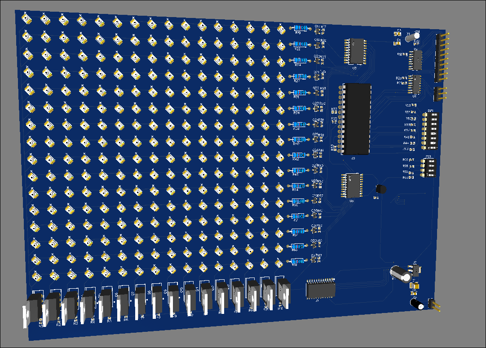

# Submission for Halflife's Week 1 PCB design

## CPULess Multiplexed LED Matrix 

### What is it ?

This is a 16x16 LED display/matrix that's driven only by logic gates and an AT28C256 EEPROM that acts as storage for images, meaning there's no Processor or microcontroller that's controlling the LEDs.

### Why does it exist ?

I was motivated to make this to challenge myself to see what it would take and if I could actually design something complex that works, hopefully!
P.S. also it will look cool on my desk and might work as a conversation starter! 

### How does it Work ?

When the board powers on, a crystal oscillator is used alongside a 74HC4060 IC counter to generate a clock signal and to (in the future) automatically cycle between images using the counter that is its intended purpose.
( this is currently handled by the DIP switches see below)

That clock signal powers a 74HC590 8-bit counter that sets which row (or column, depending on how you want to look at it) is now to be displayed
A 74HC4514 demultiplexer IC actually enforces what the counter sets and powers on one row at a time (the multiplexing part). 

Simultaneously the counter value gets passed to the EEPROM as an address.
The EEPROM then returns the values of half a column of LEDs as an 8-bit value.
The value travels through one of two buffer ICs and through some transistors to power on the selected LEDs.

On the next clock cycle the other half is displayed by the EEPROM

Then a new row is addressed until it reaches row 16, where the counter resets and the process happens all over again

### How would I use it ?

First you'd make the images you want the display to have, and put them in the `Programmer/PCB_Images` directory (the name should be the index of the image then.bmp as in 0.bmp and 1.bmp to define the image ordering). Then you'd use the resulting `output.bin` file to programm the EEPROM

Then you'd take the EEPROM and pop it in a EEPROM programmer or programm it using an arduino (see ben eater's Youtube video where he makes an EEPROM programmer using an arduino nano).

Then finally you can put it back in the PCB and turn the cuircuit on!\
(ideally you'd solder a socket for the EEPROM so you can take it in and out to reprogramm it)

The 12 DIP switches allow one to select one of 4096 possible images to be displayed on the matrix.\
(It's noteworthy to say that my implementation only allows the LEDs to be either on or off.)

## Bill of Materials

| ID | Name                 | Footprint                          | Quantity | Manufacturer Part               | Manufacturer    | Supplier | Supplier Part | Price  |
|----|----------------------|------------------------------------|----------|---------------------------------|-----------------|----------|---------------|--------|
| 1  | IRLZ44NPBF-MNS       | TO-220-3_L10.0-W4.5-P2.54-L        | 16       | IRLZ44NPBF-MNS                  | minos(迈诺斯)      | LCSC     | [C54839582](https://lcsc.com/product-detail/C54839582.html)     | 0.305  |
| 2  | AO3401CI-ES          | SOT-23-3_L2.9-W1.3-P1.90-LS2.4-BR  | 16       | AO3401CI-ES                     | ElecSuper(静芯)   | LCSC     | [C21713833](https://lcsc.com/product-detail/C21713833.html)     | 0.019  |
| 3  | 2N7000-TA            | TO-92-3_L4.5-W3.5-P1.27-L          | 1        | 2N7000-TA                       | CJ(江苏长电/长晶)     | LCSC     | [C2910414](https://lcsc.com/product-detail/C2910414.html)      | 0.045  |
| 4  | XL74HC4514D          | SOP-24_L15.3-W7.6-LS10.3-P1.27-BL  | 1        | XL74HC4514D                     | XINLUDA(信路达)    | LCSC     | [C50202050](https://lcsc.com/product-detail/C50202050.html)     | 0.31   |
| 5  | 10nF                 | C0805                              | 1        | CSA0805C0G103J500MT             | HRE(芯声)         | LCSC     | [C49270298](https://lcsc.com/product-detail/C49270298.html)     | 0.031  |
| 6  | DIP switchEI-08      | SW-TH_16P-L20.5-W6.0-P2.54         | 1        | EI-08-V                         | Diptronics(圜达)  | LCSC     | [C90019](https://lcsc.com/product-detail/C90019.html)        | 0.855  |
| 7  | HDR-M-2.54_1x10      | HDR-M-2.54_1X10                    | 1        | HX PZ-2005WV-1x10P              | hanxia(韩下)      | LCSC     | [C42391526](https://lcsc.com/product-detail/C42391526.html)     | 0.062  |
| 8  | HDR-M-2.54_1x3       | HDR-M-2.54_1X3                     | 1        | 5557WRF-1X3P(HDGC4201WR-F-1X3P) | HDGC(华德共创)      | LCSC     | [C54557117](https://lcsc.com/product-detail/C54557117.html)     | 0.176  |
| 9  | HDR-M-2.54_1x2       | HDR-M-2.54_1X2                     | 1        |                                 |                 | LCSC     | [C124375](https://lcsc.com/product-detail/C124375.html)       | 0.03   |
| 10 | 42-21A/GHC-YX1Y2N/1T | LED-SMD_L3.2-W2.4-R_GREEN          | 256      | 42-21A/GHC-YX1Y2N/1T            | EVERLIGHT(亿光)   | LCSC     | [C131211](https://lcsc.com/product-detail/C131211.html)       | 0.064  |
| 11 | 10k                  | R0603                              | 51       | MFR-12FTF52-10K                 | YAGEO(国巨)       | LCSC     | [C3356784](https://lcsc.com/product-detail/C3356784.html)      | 0.011  |
| 12 | DIP switchEI-04      | SW-TH_DIPSWITCHEI-04               | 1        | 拨码开关EI-04                       | 圜达              | LCSC     | [C99987](https://lcsc.com/product-detail/C99987.html)        | 0.522  |
| 13 | CD74HC4060M96        | SOIC-16_L10.8-W4.5-P1.27-LS6.8-BL  | 1        | CD74HC4060M96                   | TI(德州仪器)        | LCSC     | [C134017](https://lcsc.com/product-detail/C134017.html)       | 0.469  |
| 14 | 74LVC541AD-Q100J     | SO-20_L12.8-W7.5-P1.27-LS10.3-BL   | 2        | 74LVC541AD-Q100J                | Nexperia(安世)    | LCSC     | [C548810](https://lcsc.com/product-detail/C548810.html)       | 1.071  |
| 15 | SN74HC590ADR         | SOIC-16_L9.9-W3.9-P1.27-LS6.0-BL   | 1        | SN74HC590ADR                    | TI(德州仪器)        | LCSC     | [C2652997](https://lcsc.com/product-detail/C2652997.html)      | 0.852  |
| 16 | LM3940IMPX-3.3/NOPB  | SOT-223-4_L6.5-W3.5-P2.30-LS7.0-BR | 1        | LM3940IMPX-3.3/NOPB             | TI(德州仪器)        | LCSC     | [C544820](https://lcsc.com/product-detail/C544820.html)       | 1.503  |
| 17 | 32.768kHz            | DT-38_BD3.1-P1.1                   | 1        | CD02K032768ACNBAEAE             | TKD(泰晶)         | LCSC     | [C907564](https://lcsc.com/product-detail/C907564.html)       | 0.06   |
| 18 | 15Ω                  | RES-TH_BD2.3-L6.5-P10.50-D0.5      | 16       | MF1/4W-15Ω±1% T                 | CCO(千志电子)       | LCSC     | [C119285](https://lcsc.com/product-detail/C119285.html)       | 0.011  |
| 19 | 1M                   | R0603                              | 1        | FRC2512F1004TS                  | FOJAN(富捷)       | LCSC     | [C3000673](https://lcsc.com/product-detail/C3000673.html)      | 0.034  |
| 20 | 33pF                 | CAP-TH_L3.8-W2.5-P2.54-D0.5        | 2        | C315C330J2G5TA                  | KEMET(基美)       | LCSC     | [C1620398](https://lcsc.com/product-detail/C1620398.html)      | 0.199  |
| 21 | 470nF                | CAP-TH_BD4.0-P1.50-D0.8-FD         | 1        | KS474M050C07RR0VH2FP0           | Chengx(承兴)      | LCSC     | [C45094](https://lcsc.com/product-detail/C45094.html)        | 0.014  |
| 22 | 33uF                 | CAP-TH_BD5.0-P2.00-D0.8-FD         | 1        | 35YXF33MEFC5X11                 | rubycon(红宝石)    | LCSC     | [C88830](https://lcsc.com/product-detail/C88830.html)        | 0.08   |
| 23 | AT28C64B-15PU        | DIP-28_L37.0-W13.8-P2.54-LS15.8-BL | 1        | AT28C64B-15PU                   | MICROCHIP(美国微芯) | LCSC     | [C41982](https://lcsc.com/product-detail/C41982.html)        | 13.732 |
| 24 | 2.2k                 | R0603                              | 1        | MF0204FTE52-2K2                 | YAGEO(国巨)       | LCSC     | [C20611863](https://lcsc.com/product-detail/C20611863.html)     | 0.016  |
| 25 | 10uF                 | CAP-TH_BD5.0-P2.00-D0.8-FD         | 1        | 50YXF10MEFC5X11                 | Rubycon(红宝石)    | LCSC     | [C88726](https://lcsc.com/product-detail/C88726.html)        | 0.053  |
